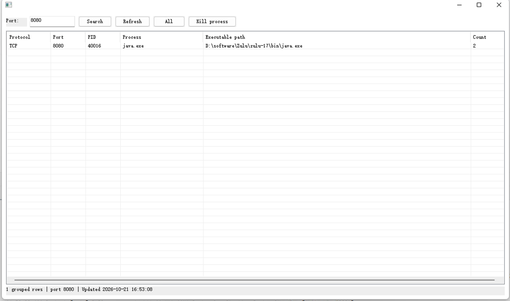

# win-port-search

Rust 原生 Windows 桌面端口查看器（开发中）。查询本机 IPv4/IPv6 TCP 监听与 UDP 端点，按端口精确检索，展示 PID、进程名与可取得的运行映像路径；列表中相同协议、端口、PID 的端点合并并显示数量。

在 [Windows build 工作流](https://github.com/hepan/win-port-search/actions/workflows/windows.yml)的主分支成功运行页面下载 `win-port-search-win7-x64` 构建产物，解压后得到 `win-port-search.exe` 和 SHA-256 校验文件。该产物保留 30 天，尚未经全部目标系统人工验收，不是正式发布版本。

## 构建

计划交付 x64 免安装 EXE。Windows 7 兼容构建须使用 Rust 的 `x86_64-win7-windows-msvc` 目标及 MSVC/Windows SDK；该目标属于 Tier 3，Rust 不提供预编译标准库，构建者须自行准备目标标准库（例如 nightly `build-std`）。`app.manifest` 在 MSVC 链接时嵌入管理员启动要求及系统列表控件依赖。普通 `x86_64-pc-windows-msvc` 目标不代表 Windows 7 兼容构建。

在安装 Rust nightly（含 `rust-src`）及 Visual Studio C++ Build Tools/Windows SDK 的 x64 Windows 构建环境中运行：

```powershell
rustup toolchain install nightly --component rust-src
cargo +nightly build -Z build-std=std,panic_abort --target x86_64-win7-windows-msvc --release --locked
```

生成的 EXE 位于 `target/x86_64-win7-windows-msvc/release/`。启动时由 Windows 请求管理员授权；拒绝授权时程序不会启动，无法由程序自身弹出说明。打开后显示当前端点列表；输入本机端口后点「Search」精确查询，清空输入后点「Search」恢复全量，「Refresh」重新查询并保留已应用筛选条件。

要终止占用进程，先在表格中选中一行，再点击「Kill process」并确认 PID 与进程名。操作强制终止**整个进程**，不是仅关闭该端口，也不会主动终止子进程；未保存的数据可能丢失。列表记录的是查询时刻的状态：执行前会核对进程创建时间，防止 PID 已复用时误杀新进程。PID 0、系统或本工具自身进程、身份不可核实及权限不足时不会终止；失败会显示原因。成功发起终止后列表重新查询；若进程退出尚未完成，可再次刷新。

发布前必须检查成品的系统 API、CRT 与外部 DLL 依赖，并在目标 Windows 上人工验收。当前 Linux 环境中的类型检查不等同于 Windows 可运行性验证。

## 目标系统与人工验收

以下是**计划支持范围**，不是全部系统均已验证的兼容性声明。只计划提供 x64 版本，不支持 32 位系统或 ARM64。CI 提供未正式发布的 EXE；“已测试”仅在对应系统收到人工测试反馈后标记。Windows Server 仅包含可运行桌面程序的完整 GUI / Desktop Experience 安装，不包含 Server Core。

| 系统 | 计划架构 | 计划支持 | 已测试 |
| --- | --- | --- | --- |
| Windows 7 SP1 | x64 | 是 | 否 |
| Windows 8 | x64 | 是 | 否 |
| Windows 8.1 | x64 | 是 | 否 |
| Windows 10 | x64 | 是 | 否 |
| Windows 11 | x64 | 是 | 是（人工反馈：启动及端口查询正常） |
| Windows Server 2008 R2 | x64 | 是（完整 GUI） | 否 |
| Windows Server 2012 | x64 | 是（完整 GUI） | 否 |
| Windows Server 2012 R2 | x64 | 是（完整 GUI） | 否 |
| Windows Server 2016 | x64 | 是（Desktop Experience） | 否 |
| Windows Server 2019 | x64 | 是（Desktop Experience） | 否 |
| Windows Server 2022 | x64 | 是（Desktop Experience） | 否 |
| Windows Server 2025 | x64 | 是（Desktop Experience） | 否 |

Windows 11 x64 人工测试截图：按端口 8080 查询，显示 TCP、PID、进程名、运行路径及合并端点数量。截图不证明「Kill process」按钮已在该系统上完成单独验收。



其他目标系统的启动和查询仍待逐项人工验收；管理员权限不能保证每条记录都有进程名和路径，PID 为 0 不表示已识别出占用进程。
